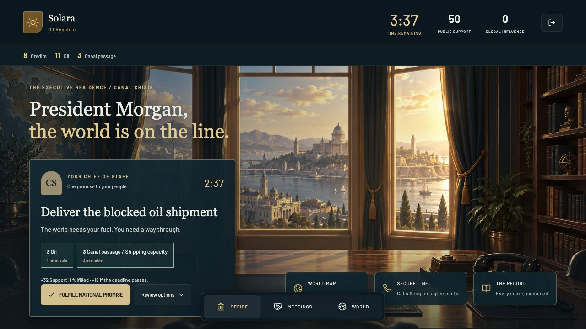

# Republic — The Canal Crisis

**Five minutes to win your people's trust and the world's respect.**

A multiplayer negotiation party game for **2–6 friends**. Random advantages, scarce supplies,
private diplomatic calls, binding deals and one shared crisis. No accounts. Talk across the
room or use private chat. Every President stays until the end.



## Run locally

Requires Node **20.19+** (Node 22 recommended) and npm.

```sh
npm ci
npm run dev
```

Open **http://localhost:3000**. The authoritative API listens on **http://localhost:4000**.
Development automatically creates a persistent PostgreSQL-compatible PGlite database
in `apps/server/.data/republic`. No Docker or PostgreSQL installation is needed.
Room state survives frontend refreshes and server restarts. The five-minute deadline continues during disconnects and server downtime; overdue outcomes
settle on recovery. Refreshing never restarts the match.

Create a game, invite one to five friends with the room code, then deal the advantages.
Everyone receives one randomly assigned role in the Canal Crisis. Read your national goal,
call another President, negotiate terms, sign together and fulfill your promise. In a two-player game, authorize an oil shipment, negotiate canal maintenance, then deliver an
emergency order. Larger groups receive a shared midpoint crisis. At 5:00 results appear, or
the host can end early from the Game menu.

Use different browsers/profiles for independent local players. A tab refresh resumes its
saved seat. Returning to the title retains a Resume button. Creating/joining another world
replaces the current saved seat; do not clear browser storage during a game.

### Friends on the same network

Both services bind to `0.0.0.0`. Set `NEXT_PUBLIC_API_URL` in `apps/web/.env.local` to
`http://YOUR_LAN_IP:4000`, and `CLIENT_ORIGIN` in the root `.env` to
`http://YOUR_LAN_IP:3000,http://localhost:3000`. Restart `npm run dev`, then share
`http://YOUR_LAN_IP:3000`. Each friend needs their own browser storage.

## Workspace

| Location | Responsibility |
| --- | --- |
| `apps/web` | Next.js and feature-local cinematic React UI |
| `apps/server` | Fastify, Socket.IO, authenticated seats, room queues and persistence |
| `packages/contracts` | Shared types, validation, assets and balancing constants |
| `packages/engine/src/party` | Pure Canal Crisis rules, escrow, evaluation, scoring and deadlines |
| `packages/api-client` | HTTP, sockets, retries and browser session storage |

Source files stay below 250 lines. Components do not call transport APIs directly.
The prior simulator is isolated for saved-data compatibility and regression coverage;
its draft, policies, charts and war are absent from the active game.

See [game rules](docs/game-rules.md), [architecture](docs/architecture.md),
[migration plan](docs/party-migration.md) and [playtest record](docs/playtest.md).

## Validate

```sh
npm run check         # types, unit/integration tests, 250-line limit
npm run format:check
npm run build         # production frontend, Webpack
```

Integration tests open local sockets and use embedded PostgreSQL. Development controls in
World can advance time, force the twist, adjust inventory, add a need or end the round.
They require host ownership and are rejected by the production server. Development hosts can
also Reset Match from the Game menu and choose a three-minute test round in the lobby.
See [connected-loop rules and verification](docs/connected-loop-verification.md).

## Deployment preparation (not deployed)

**Railway backend:** deploy the repository root using the checked-in Dockerfile and
`railway.json`. Attach PostgreSQL and set `DATABASE_URL`, `NODE_ENV=production`, and
`CLIENT_ORIGIN=https://YOUR_FRONTEND_DOMAIN`. Railway supplies `PORT`. Run **one replica**:
the V0 room scheduler and room cache have a single owner. `/health` is the readiness endpoint.
Production refuses to start without PostgreSQL. Do not run separate servers against the
same database. A later scaling phase needs distributed room ownership, not just more replicas.

**Vercel frontend:** import the repository, select Next.js, set root directory to `apps/web`,
and include files outside the root directory so workspace packages are available. Set
`NEXT_PUBLIC_API_URL=https://YOUR_RAILWAY_BACKEND_DOMAIN` before building. Build command:
`npm run build`. The browser connects directly to Railway for HTTP and Socket.IO.
Use HTTPS on both sides and put the final frontend origin in Railway's allowlist.

Platform references: [Railway Dockerfiles](https://docs.railway.com/builds/dockerfiles) and
[Vercel monorepos](https://vercel.com/docs/monorepos).

Neither service has been deployed. Infrastructure configuration is prepared for the later
deployment phase; Docker/Railway/Vercel provisioning is not part of local verification.

## V0 boundaries

- One scenario, three seeded midpoint twists, unique roles for every player count from two to six.
- Immediate or 15/30-second escrowed deliveries; no unenforceable future promises in treaties.
- One primary national obligation and one optional crisis response. Neutral relief prevents deadlock.
- Support and Influence are explained in a server ledger; final Legacy uses 70% / 30% weights.
- No matchmaking, spectators, host migration, competitive bots or recovery after losing a seat token.
- One backend replica. No deployment has been performed.
- Automated and browser checks validate mechanics. A session with friends is still needed to judge
  whether negotiating prices, role balance and five-minute pacing are fun.
