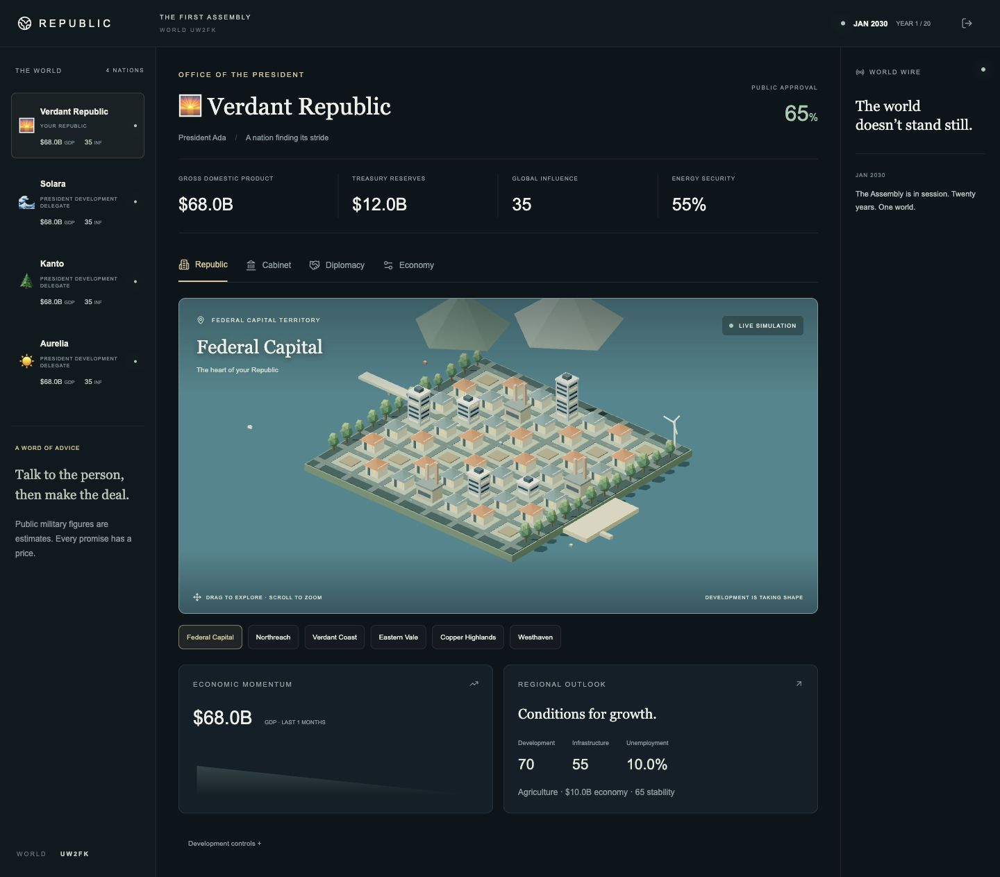

# Republic — First Assembly

A playable V0 of a multiplayer political strategy party game. Two to eight friends
lead separate Republics through twenty simulated years. Negotiate in person or over
voice; record the agreements in the game. There are no accounts.



## Run locally

Requires Node **20.19+** (Node 22 recommended) and npm.

```sh
npm ci
npm run dev
```

Open **http://localhost:3000**. The authoritative API listens on **http://localhost:4000**.
Development automatically creates a persistent PostgreSQL-compatible PGlite database
in `apps/server/.data/republic`. No Docker or PostgreSQL installation is needed.
Room state survives frontend refreshes and server restarts. Server downtime pauses the clock.

Create a world, choose your Republic, then invite three friends using the room code.
For a solo smoke test, use **Add development delegate** three times and start the Assembly.
Delegates accept affordable offers, sign pacts, vote and resolve crises. They are deterministic
test helpers, not competitive AI. Production cannot create delegates or use debug actions.

Use different browsers/profiles for independent local players. A tab refresh resumes its
saved seat. Returning to the title retains a Resume button. Creating/joining another world
replaces the current saved seat; do not clear browser storage during a game.

### Friends on the same network

Both services bind to `0.0.0.0`. Set `NEXT_PUBLIC_API_URL` in `apps/web/.env.local` to
`http://YOUR_LAN_IP:4000`, and `CLIENT_ORIGIN` in the root `.env` to
`http://YOUR_LAN_IP:3000,http://localhost:3000`. Restart `npm run dev`, then share
`http://YOUR_LAN_IP:3000`. Each friend needs their own browser storage.

## Workspace

| Location | Responsibility |
| --- | --- |
| `apps/web` | Next.js, React, Tailwind, feature-local UI and React Three Fiber scenes |
| `apps/server` | Fastify, Socket.IO, secure sessions, authoritative queues and database |
| `packages/contracts` | Shared types and Zod request schemas |
| `packages/engine` | Seeded monthly simulation, diplomacy, war and scoring |
| `packages/api-client` | HTTP calls, socket lifecycle, action retries and session storage |

All source files are limited to 250 lines. Transport/API calls live outside UI components.
See [architecture](docs/architecture.md), [game rules](docs/game-rules.md), and
[local playtest checklist](docs/playtest.md).

## Validate

```sh
npm run check     # TypeScript, unit/integration tests, source-file limit
npm run build     # Production frontend build (Webpack)
npm audit
```

Integration tests use temporary local sockets and an in-memory PostgreSQL database.
The frontend uses Webpack for production builds because the local sandbox's Turbopack
CSS worker could not bind its process port. Development uses the Next.js default bundler.

## Deployment preparation (not deployed)

**Railway backend:** deploy the repository root using the checked-in Dockerfile and
`railway.json`. Attach PostgreSQL and set `DATABASE_URL`, `NODE_ENV=production`, and
`CLIENT_ORIGIN=https://YOUR_FRONTEND_DOMAIN`. Railway supplies `PORT`. Run **one replica**:
the V0 room scheduler and room cache have a single owner. `/health` is the readiness endpoint.
Production refuses to start without PostgreSQL. Do not run separate servers against the
same database. A later scaling phase needs distributed room ownership, not just more replicas.

**Vercel frontend:** import the repository, select Next.js, set root directory to `apps/web`,
and include files outside the root directory so workspace packages are available. Set
`NEXT_PUBLIC_API_URL=https://YOUR_RAILWAY_BACKEND_DOMAIN` before building. Build command:
`npm run build`. The browser connects directly to Railway for HTTP and Socket.IO.
Use HTTPS on both sides and put the final frontend origin in Railway's allowlist.

Platform references: [Railway Dockerfiles](https://docs.railway.com/builds/dockerfiles) and
[Vercel monorepos](https://vercel.com/docs/monorepos).

Neither service has been deployed. Infrastructure configuration is prepared for the later
deployment phase; Docker/Railway/Vercel provisioning is not part of local verification.

## V0 boundaries

- Twenty years, three session lengths, one host, two to eight seats; no account system.
- Seven strategic resources, eight policies, six persistent regional scenes per Republic.
- Bilateral recurring deals, counters, pacts, loans, sanctions, votes and six crisis templates.
- Six-month abstract wars with outside support, bounded losses and reparations; no conquest.
- Five-category score, awards, table-talk statistics and same-seat rematches.
- Snapshot persistence; one backend replica. No spectator/rejoin-seat recovery after token loss,
  host transfer, matchmaking, chat, competitive bots or distributed scaling.
- Balance values are explicit V0 tuning parameters. Automated testing validates mechanics;
  the 4–8-person, 60–90-minute social hypothesis still requires human playtesting.
